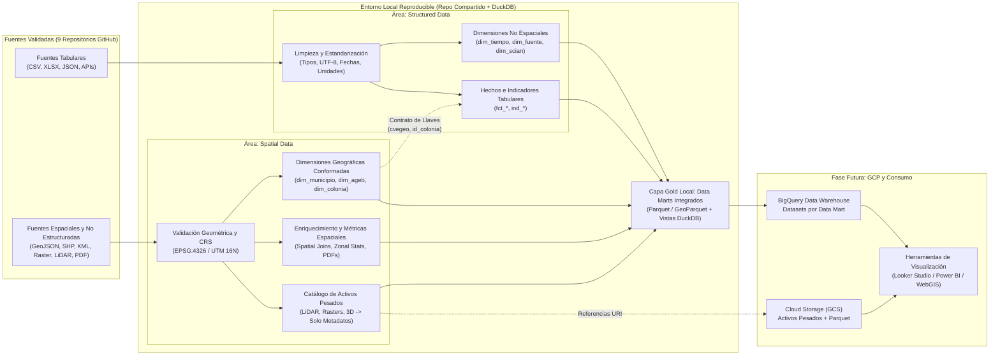
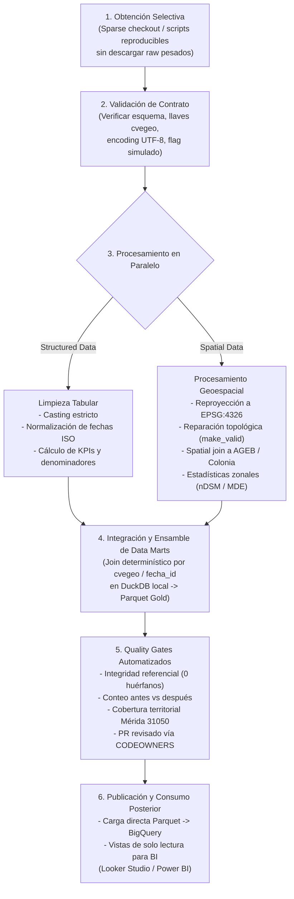
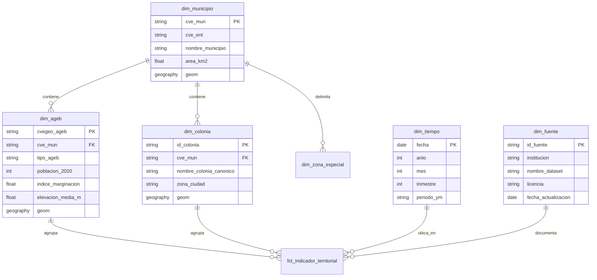

# Análisis Integral de Coordinación: Spatial Data & Structured Data

> **Proyecto:** Integración Analítica y Geoespacial de los 9 Proyectos de Mérida / Yucatán (UPY)  
> **Documento base analizado:** `PlanDataTeam.pdf`  
> **Enfoque:** Diseño local y construcción coordinada de Data Marts limpios (Capa Gold) orientados a consumo analítico, sin dependencia inmediata de GCP ni procesamiento de *raw data* en la nube.  
> **Fecha de auditoría de repositorios:** 25 de noviembre de 2026 *(actualizado con la migración a arquitectura Medallion del Equipo 3)*

---

## 1. Resumen Ejecutivo

El proyecto busca consolidar **nueve iniciativas independientes de la Unidad 2** —todas centradas en fenómenos urbanos, ambientales, socioeconómicos y de movilidad de Mérida y Yucatán— en un **único Data Warehouse analítico con Data Marts temáticos integrados**. Sin embargo, el análisis crítico de `PlanDataTeam.pdf` y la auditoría técnica en vivo de los nueve repositorios de GitHub revelan que **el principal riesgo del proyecto no es el volumen de datos, sino la asimetría extrema de madurez entre repositorios y la ausencia de contratos de integración entre áreas**.

### Hallazgos clave de la auditoría

1. **Accesibilidad total, con 6 de 9 repositorios listos para Ola 1:** Los **9 repositorios son públicos y accesibles (`HTTP 200`)**, y su estado operativo se divide en tres niveles:
   - **Listos para Data Mart (Alta madurez — 6 repositorios):** Equipos **8** (*Del tren a la calle*, capas Silver/Gold en Parquet y dimensiones compartidas), **3** (*Resiliencia y Salud UPY*, actualizado en `origin/main` vía commit `28bf5fd` bajo estándar Medallion Bronze→Silver→Gold con 6.27 MB de datos reales, 0 archivos `sample_*`, GeoParquet en `EPSG:4326` y 18/18 tablas aprobadas), **6** (*Datos viales de Mérida*, CSV/GeoJSON enriquecidos), **9** (*Mérida for Sale*, 9 secciones limpias + GeoJSON + LiDAR nDSM), **1** (*Mérida, Ciudad Esponja*, 27 fuentes catalogadas) y **2** (*¿Cuánto cuesta comer?*, tablas ya estructuradas para Looker Studio).
   - **Requieren intervención intensiva (Madurez media/baja — 2 repositorios):** Equipo **5** (*Percepción de inseguridad*, sin `README.md`, archivos comprimidos crudos, múltiples PDFs y punteros Git LFS de 0.1 KB) y Equipo **7** (*Water Situation Sources*, **1.42 GB** en Git con 65+ ZIPs de MDE que no son LiDAR real sobre Yucatán y datos propios simulados).
   - **Bloqueante por falta de datos reales (Madurez crítica — 1 repositorio):** Equipo **4** (*Sentir la Calle*), cuyo repositorio contiene únicamente archivos `sample_*` de 0.0 KB a 0.7 KB y scripts de descarga/generadores sintéticos sin salidas ejecutadas, sin actualizaciones desde octubre de 2026.
2. **Duplicación masiva de cartografía y fuentes base:** El Marco Geoestadístico de INEGI (AGEBs y municipio `31050`), el Censo 2020, DENUE, ATUS y los boletines de SIEGY están duplicados de forma independiente en entre 3 y 6 repositorios distintos, con diferentes nombres de columnas, formatos y recortes territoriales.
3. **Riesgo de retrabajo en el flujo secuencial acordado:** El acuerdo interno de que **Structured Data** construya los primeros Data Marts y posteriormente los entregue a **Spatial Data** para enriquecimiento espacial puede generar retrabajo si no se congelan **antes** las llaves territoriales (`cvegeo`, `cve_mun`, `cve_ageb`, `id_colonia`), los catálogos maestros y las dimensiones conformadas.
4. **Vacíos en `PlanDataTeam.pdf`:** El documento omite las responsabilidades del **Equipo TI** (acceso a GCP, almacenamiento de *raw data*), presenta contradicciones entre el alcance original (Bronze/Silver/Gold completo) y las notas de *Actualización* (solo *features* para visualizaciones), no documenta el catálogo de temas de los 9 proyectos y tiene inconsistencias en la asignación de integrantes.

### Recomendación central

Adoptar un enfoque **Contract-First (Contrato primero)** en el repositorio compartido `Structured_GeoSpatial_Data_Team`: **Spatial Data** debe publicar en la Fase 0 las **Dimensiones Geográficas Conformadas** (`dim_municipio`, `dim_ageb`, `dim_colonia`, `dim_zona_especial`) y el contrato de esquema, mientras **Structured Data** construye las tablas de hechos e indicadores de los **6 Data Marts prioritarios** (Equipos 8, 3, 6, 9, 1 y 2) referenciando esas mismas llaves. Así ambos equipos avanzan en paralelo real en entorno local (DuckDB + Parquet/GeoParquet) y la migración futura a BigQuery/GCP se reduce a una carga directa sin reingeniería.

---

## 2. Análisis del Documento `PlanDataTeam.pdf`

### 2.1 Estructura real vs. índice y vacíos documentales

El documento consta de 5 páginas y presenta varias inconsistencias estructurales que conviene corregir o clarificar formalmente entre áreas:

| Aspecto | Lo que indica `PlanDataTeam.pdf` | Hallazgo crítico / Brecha detectada |
|---|---|---|
| **Paginación e Índice** | El índice indica 4 páginas y omite la sección final. | El documento tiene 5 páginas; la sección crítica *"Integración y Data Marts"* (pág. 5) ni siquiera figura en el índice. |
| **Equipo TI** | Aparece en la lista de equipos (pág. 2) con 3 integrantes resaltados en magenta. | **No existe ninguna sección de actividades ni entregables para TI.** No define quién provee GCP, permisos IAM, buckets de Data Lake ni los procesos de capa *raw*. |
| **Asignación de personal** | Lista 4 equipos: TI, Structured, Spatial y Data Visualization. | Existen inconsistencias de plantilla: una integrante figura duplicada en Spatial y Visualization; dos integrantes presentes en la tabla de fuentes (Equipos 5 y 7) no aparecen asignados a ningún equipo funcional. Además, el PDF lista un único responsable por área, mientras que la coordinación interna opera con co-responsables en Structured y Spatial. |
| **Catálogo de los 9 temas** | Página 5 exige construir Data Marts *"correspondientes a los nueve temas originales"*. | El PDF **nunca nombra los temas ni las preguntas analíticas** de los 9 proyectos; solo proporciona URLs de GitHub. |
| **Alcance original vs. *Actualización*** | Las secciones originales exigen Bronze/Silver/Gold completo, OCR de PDFs, Potree para LiDAR y modelos 3D GLB/glTF. | Las notas de *"Actualización"* (págs. 3–4) reducen el alcance a **priorizar únicamente las *features* usadas en las gráficas de la Unidad 2 y las variables necesarias para relacionar proyectos**, dejando LiDAR y modelos 3D fuera del DW (solo referenciados en el Data Lake). |
| **Catálogo de visualizaciones** | No se menciona en el PDF. | En el repositorio del Equipo 2 se referencia un repositorio externo (`valnix140405/visual-modeling-catalogo`) con el catálogo de visualizaciones de los 9 equipos; es un insumo indispensable para aplicar el criterio de *Actualización*. |

### 2.2 Objetivos, alcances y responsabilidades por área

Alineando las notas de *Actualización* de `PlanDataTeam.pdf` con las restricciones operativas actuales (trabajo local inicial, sin *raw data* en GCP, enfoque exclusivo en Data Marts limpios):

#### Área: Structured Data
- **Objetivo:** Producir tablas limpias, estandarizadas y reproducibles a partir de fuentes tabulares y semiestructuradas (CSV, Excel, JSON, APIs) enfocadas en las variables analíticas de los 9 temas.
- **Alcance en esta fase (local → Data Marts):**
  - Extraer y depurar únicamente las *features* con valor analítico o relacional (descartando columnas administrativas irrelevantes).
  - Corregir tipos de datos, codificación UTF-8, fechas ISO, unidades de medida y claves territoriales.
  - Calcular indicadores reproducibles documentando explícitamente fórmula, numerador y denominador.
  - Construir dimensiones no espaciales compartidas (`dim_tiempo`, catálogos SCIAN/giros, catálogos de fuentes) y tablas de hechos tabulares (`fct_*`) / indicadores (`ind_*`).
  - Entregar scripts ETL versionados, archivos curados en **Parquet** (y CSV de respaldo cuando aplique), diccionario de columnas y reporte de calidad.
- **Fuera de alcance en esta fase:** Ingesta de *raw data* en GCP, procesamiento de geometrías complejas, rasters, nubes de puntos LiDAR o extracción masiva de PDFs sin tablas estructuradas.

#### Área: Spatial Data
- **Objetivo:** Garantizar la integridad territorial y geométrica de todo el Data Warehouse, construir las dimensiones geográficas conformadas y generar métricas espaciales tabulares derivadas de capas vectoriales, rasters, LiDAR, PDFs técnicos y activos 3D.
- **Alcance en esta fase (local → Data Marts):**
  - Construir la **capa cartográfica maestra (Single Source of Truth)** para Mérida y Yucatán: homologar CRS, validar topología/geometrías y estandarizar llaves (`cvegeo`, `cve_mun`, `cve_ageb`, `id_colonia`).
  - Procesar fuentes vectoriales (GeoJSON, SHP, KML/KMZ, GeoPackage) y producir **GeoParquet** / geometrías WKT compatibles con BigQuery `GEOGRAPHY`.
  - Extraer métricas espaciales agregadas por unidad territorial (estadísticas zonales de elevación/nDSM, conteos por polígono, distancias/isócronas, densidad de equipamiento) para integrarlas en los Data Marts como columnas analíticas limpias.
  - Extraer y verificar tablas de documentos PDF oficiales (cuando contienen indicadores críticos faltantes en fuentes tabulares).
  - Mantener un **catálogo de activos pesados** (LiDAR, modelos 3D GLB/glTF, rasters crudos) fuera de las tablas de hechos, registrando únicamente sus metadatos y rutas de referencia (`asset_uri`, `bbox`, `crs`, `licencia`).
- **Fuera de alcance en esta fase:** Almacenamiento de archivos binarios pesados (>50 MB) en Git o en tablas analíticas del DW, construcción de dashboards finales y administración de infraestructura GCP.

#### Dependencias con áreas externas (fuera del análisis detallado)
- **Área TI / Raw Data:** Proveerá posteriormente el entorno GCP (buckets GCS para Data Lake/Bronze y activos pesados, dataset de BigQuery para Data Marts, cuentas de servicio e IAM).
- **Área Data Visualization:** Definirá/validará la lista definitiva de KPIs, filtros y granularidades requeridas por las gráficas de la Unidad 2 y consumirá únicamente vistas/tablas aprobadas de la capa Gold.

---

## 3. Análisis de las Fuentes de Datos

Los nueve repositorios fueron estructurados originalmente bajo una matriz de hasta 9 tipos de fuentes por proyecto. Al consolidar el ecosistema completo se identifican **ocho familias de fuentes** con comportamientos distintos para Structured y Spatial:

| Familia de fuente | Equipos que la usan | Naturaleza predominante | Cobertura temporal detectada | Compatibilidad y observaciones críticas |
|---|---|---|---|---|
| **INEGI Marco Geoestadístico (AGEB, Municipio, Localidad)** | 2, 6, 8, 9 | Espacial (GeoJSON / SHP en ZIP) | 2020–2024 | **Alta compatibilidad**, pero replicada en 4 repositorios con esquemas y filtros distintos (solo Mérida `31050` vs. todo Yucatán `31`). Debe centralizarse en Spatial. |
| **INEGI Tabular (Censo 2020, DENUE, ATUS, ENOE, ENSU, ENVIPE)** | 2, 3, 4, 5, 6, 8, 9 | Estructurada + Coordenadas (lat/lon) | 2010–2026 (según encuesta) | **Muy alta calidad y trazabilidad.** DENUE y ATUS traen coordenadas puntuales que requieren validación espacial (`point-in-polygon`) para asignar `cve_ageb` y `id_colonia` consistentes. |
| **Datos Abiertos Federales (`datos.gob.mx`: CONAGUA, SMN, CENAPRED, PROFECO, SICT, CONAPO, DataTur, ASUR, SESNSP)** | 1, 2, 3, 5, 6, 7, 8, 9 | Estructurada (CSV, XLS/XLSX, JSON) | 1985–2026 | **Buena cobertura**, pero alta heterogeneidad de formatos (ej. 36 archivos `.xls` legacy 1985–2020 en Eq. 1; CSVs de SESNSP de 12 MB en Eq. 5). |
| **SIEGY Yucatán (Boletines e indicadores estatales)** | 1, 2, 3, 5, 6, 7, 8, 9 | Mixta (CSV + PDFs de boletines) | 2024–2026 | **Riesgo de transcripción manual.** Varios equipos transcribieron tablas desde PDFs de SIEGY; requiere verificación de consistencia cuando el mismo boletín se usa en dos temas. |
| **GeoPortal Mérida / OpenStreetMap / ATY (Va y Ven)** | 1, 2, 3, 4, 5, 6, 7, 8, 9 | Espacial (GeoJSON, KML/KMZ, XLSX) | 2024–2026 | **Muy valiosa para granularidad intraurbana** (colonias, Centro Histórico, zonas patrimoniales, paraderos, ciclovías, parques, edificios Overture/OSM). Requiere homologación de nombres de colonias (sin llave oficial única). |
| **Solicitudes de Transparencia (PNT) y Gobierno Municipal** | 1, 3, 4, 5, 7, 8, 9 | PDFs de oficios + XLS/CSV derivados | 2015–2026 | **Alto valor analítico único** (reportes de drenaje, licencias del Centro, impuesto de hospedaje, Tren Maya, obras de banquetas). En Eq. 8 existen respuestas *simuladas* etiquetadas temporalmente. |
| **Web Scraping / Prensa / Redes / GDELT / Wikipedia** | 1, 2, 3, 4, 6, 7, 8, 9 | Semiestructurada (CSV, JSON, PDF) | 2017–2026 | **Útil solo si está agregada.** Los artículos crudos y URLs candidatas no deben entrar al Data Mart; solo conteos por tema, fecha, sentimiento y mención territorial. |
| **LiDAR, MDE Raster y Activos 3D / AR** | 1, 2, 3, 4, 5, 6, 7, 8, 9 | Binaria pesada (TIF, ZIP, PLY, GLB, USDZ, PDB) | 2013–2026 | **Mayor foco de riesgo técnico.** Eq. 9 cuenta con GeoTIFF nDSM limpio y Eq. 3 con malla real Copernicus DEM GLO-90 (400 pts en GeoParquet) y cabecera real PDB 6VXX (250 KB); en contraste, Eq. 7 aclara que los MDE de INEGI en Yucatán **no son LiDAR real**, Eq. 5 tiene un ZIP corrupto/LFS de 0.1 KB, Eq. 8 usa capturas `.ply` simuladas y Eq. 4 tiene JSONs vacíos/muestra. |

---

## 4. Validación de Repositorios y Datasets

Se ejecutó una auditoría directa vía API de GitHub sobre los 9 repositorios listados en `PlanDataTeam.pdf` (incluyendo verificación de GitHub Pages, tamaño, número de archivos, fecha de último `push`, presencia de documentación y tipos de archivos).

### 4.1 Matriz consolidada de validación

| Eq. | Repositorio | Tema identificado | Estado HTTP / Pages | Último push (UTC) | Tamaño / Archivos | Cobertura y actualidad | Calidad y accesibilidad de datos | Semáforo |
|---|---|---|---|---|---|---|---|---|
| **1** | `joseeangel0/merida-ciudad-esponja` | Precipitación y eventos de lluvia en Mérida | `200` / Pages `200` | 2026-11-25 | 14.7 MB / 160 | 1985–2026 (SMN, CENAPRED, PROCIVY, Ayuntamiento) | Alta: 27 fuentes catalogadas, diccionarios de columnas, GeoJSONs de edificios con altura, PDFs PNT ya tabulados en CSV. | **Verde** |
| **2** | `valnix140405/visual_modeling` | Salario, canasta básica y acceso alimentario | `200` / Pages activo* | 2026-11-25 | 22.4 MB / 162 | 2018–2026 (PROFECO, DENUE, CONEVAL, ENOE, Censo 2020) | Alta: 22 fuentes documentadas, 6 CSVs ya curados para Looker Studio, GeoJSON de mercados y rutas Va y Ven, modelos `.glb`. | **Verde** |
| **3** | `RusselKu/Mexico-DataViz-by-UPY` | Resiliencia comunitaria, salud y entorno UPY | `200` / Pages `200` | 2026-11-25 (`28bf5fd`) | 6.27 MB (`data/`) / 9 módulos | Completa y real: 504 unidades salud OSM, 500 días DGE, 106 municipios, 884 parques + 243 comisarías, 190 hospitales, 235 noticias RSS, 166 encuestas UPY, DEM GLO-90 20×20, PDB 6VXX | **Referencia (Medallion):** Publicado en `origin/main` (`28bf5fd`): Bronze→Silver→Gold en Parquet + GeoParquet (`EPSG:4326`, métricas en `EPSG:32616`), 0 `sample_*`, catálogo + diccionario + reporte de calidad (`18/18 APROBADO`). | **Verde** |
| **4** | `Rivaldo2309030/Visual-Modeling-For-Information` | Seguridad peatonal, confort térmico e infraestructura | `200` / Pages `200` | 2026-10-19 | 0.31 MB / 48 | Sin datos procesados en repo (solo scripts) | **Crítica:** Archivos GeoJSON/JSON de `0.0 KB` a `0.7 KB` (`sample_*`). Contiene scripts de descarga/proceso (ATUS, PNT, sintéticos) sin salidas ejecutadas. | **Rojo** |
| **5** | `ldpl3012/percepcion-inseguridad-yucatan` | Percepción de inseguridad y delitos en Yucatán | `200` / Sin Pages | 2026-11-17 | 46.9 MB / 34 | 2024–2026 (ENSU 1T–3T 2026, ENVIPE 2026, SESNSP dic25) | **Media-Baja:** Sin `README.md` (404), sin scripts ETL. 3 archivos (`IDM_NM_dic25.csv`, `INM_estatal_dic25.csv`, `e31_cem_r15_v4_tif.zip`) pesan **0.1 KB** (punteros Git LFS no resueltos o rotos). 6 PDFs sin extraer. | **Amarillo** |
| **6** | `jonavm/merida-datos-viales` | Accidentes viales en Mérida (`31050`) | `200` / Sin Pages | 2026-11-21 | 4.4 MB / 37 | 2021–2025 (8,815 accidentes ATUS, SICT, DENUE, SIEGY) | **Muy Alta:** Estructura `originales/` vs `para-etl/`, GeoJSONs de AGEB urbana/rural y municipio, trazabilidad (`provenance.json`, `validacion.json`). | **Verde** |
| **7** | `Audileleach/Water_situation_Sources` | Situación hídrica, acuífero y cenotes en Yucatán | `200` / Sin Pages | 2026-11-01 | **1,419.7 MB** / 169 | 2013–2026 (SMN sequía, CONAGUA SINA, NASA G-LiHT, Cuxtal) | **Media (con alertas):** `manifest.csv` con SHA-256 excelente, pero repo inflado por 65+ ZIPs de MDE INEGI que **no son LiDAR sobre Yucatán**, 2 fuentes AR inexistentes (`❌`) y datos propios **simulados (`🧪`)**. | **Amarillo** |
| **8** | `ezraidenn/del-tren-a-la-calle` | Accesibilidad urbana alrededor del Tren Maya | `200` / Sin Pages | 2026-11-25 | 127.8 MB / 339 | 2020–2026 (CONAPO, Censo AGEB, ATY R901, Tren Maya, OSM) | **Referencia (Gold Standard):** Implementa Bronze/Silver/Gold en CSV + Parquet, `catalogo_tablas.csv`, `diccionario_columnas.csv`, `dim_*` e `ind_*`. Alerta: subcarpeta `datos/simulados/` pendiente de reemplazo real. | **Verde** |
| **9** | `BradRobles/M-rida-for-Sale` | Turistificación y gentrificación en Mérida | `200` / Sin Pages | 2026-11-25 | 81.4 MB / 166 | 2010–2026 (DENUE 2019 vs 2025, DataTur, ASUR, SHF, AAFY, GDELT) | **Muy Alta:** Scripts limpios por sección (1–9), GeoJSONs limpios (AGEBs, colonias, Centro Histórico, zonas patrimoniales) y raster `lidar_ndsm_centro.tif` ya procesado. | **Verde** |

*\*Nota: El Equipo 2 sí tiene GitHub Pages publicado (`https://valnix140405.github.io/visual_modeling/`), aunque no estaba listado en `PlanDataTeam.pdf`.*

### 4.2 Diagnóstico crítico de hallazgos específicos

1. **Bloqueo aislado al Equipo 4 (tras la actualización del Equipo 3):** El **Equipo 3** salió del estado bloqueante al publicar en `origin/main` (`28bf5fd`) sus 9 módulos con datos reales bajo estándar Medallion. Con esto, **el único repositorio bloqueante por falta de datos reales es el Equipo 4**.
   - *Alternativa viable para Equipo 4:* Gran parte de su columna vertebral espacial y de siniestralidad (ATUS + AGEB + DENUE) ya existe limpia en el **Equipo 6** y el **Equipo 8** (banquetas/infraestructura peatonal); conviene ejecutar sus scripts de descarga (`download_inegi_atus.py`, `fetch_municipal_crossings.py`) o consolidar la extracción con fuentes reales de GeoPortal/OSM.
2. **Punteros Git LFS rotos o no hidratados en Equipo 5:** Los archivos `IDM_NM_dic25.csv`, `INM_estatal_dic25.csv` y `e31_cem_r15_v4_tif.zip` registran `0.1 KB`. Al clonar sin `git lfs pull` (o si el propietario nunca subió los objetos binarios LFS), quedarán inservibles. Además, el repositorio carece de `README.md` y scripts reproducibles.
3. **Contaminación de datos simulados en Equipos 4, 7 y 8:** Si los datos simulados o sintéticos se mezclan en los Data Marts sin un atributo de control, invalidarán las conclusiones del dashboard integrado. **Regla obligatoria:** toda tabla que contenga registros simulados debe incluir la columna booleana `es_dato_simulado` (o excluirse de la vista de producción del Data Mart hasta ser reemplazada).
4. **Riesgo de clonar el Equipo 7 (`1.42 GB`):** Clonar el repositorio completo de forma ingenua descargará más de 1.3 GB de ZIPs de modelos de elevación que el propio README marca como no-LiDAR. Se debe usar `git clone --filter=blob:none --sparse` para extraer únicamente los CSVs, GeoJSONs, KMZs y `manifest.csv` necesarios.
5. **Ausencia total de licencias formales (`License: None` en los 9 repositorios):** Aunque varios incluyen metadatos de procedencia (Equipos 1, 2, 6, 7, 8), conviene estandarizar un archivo de atribución de fuentes oficiales (INEGI, CONAGUA, Ayuntamiento de Mérida, OSM/ODbL) dentro del catálogo del DW.

---

## 5. Arquitectura Propuesta

### 5.1 Principios arquitectónicos (Local-First, Cloud-Ready)

Dado que **no existe acceso a GCP en esta fase** y que los **datos crudos (*raw*) serán gestionados por otra área**, la arquitectura propuesta opera completamente en **entorno local reproducible**, usando formatos columnares abiertos compatibles 1:1 con BigQuery y Google Cloud Storage (GCS):

- **Motor analítico local:** **DuckDB** (con extensión `spatial`) + **Python** (`pandas`/`polars`, `geopandas`, `pyarrow`, `shapely`). DuckDB permite ejecutar SQL analítico y espacial directamente sobre archivos Parquet/GeoParquet locales sin necesidad de instalar servidores de base de datos, y su dialecto SQL migra con fricción mínima a BigQuery.
- **Formato de intercambio entre áreas:**
  - Tablas estructuradas y métricas espaciales tabulares → **Apache Parquet (`.parquet`)** (tipado estricto, compresión Snappy, lectura directa en BigQuery y DuckDB).
  - Capas vectoriales y dimensiones geométricas → **GeoParquet (`.parquet`)** en `EPSG:4326` (WGS84) + respaldo en **GeoJSON** ligero solo cuando sea requerido por herramientas de visualización.
  - Esquemas y contratos → **YAML/JSON Schema** + pruebas automáticas de calidad en Python (`pytest` / validaciones de esquema).
- **Separación estricta de activos pesados:** Nubes de puntos LiDAR, rasters crudos (`.tif` pesados) y modelos 3D (`.glb`/`.ply`/`.usdz`) **nunca entran a Git ni a las tablas de hechos**. Se registran en `dim_catalogo_activos_espaciales.parquet` con su URI lógica (local hoy, `gs://bucket/...` mañana).

### 5.2 Arquitectura conceptual entre Structured Data y Spatial Data



### 5.3 Prototipo del flujo de trabajo completo (End-to-End)



---

## 6. Estrategia de Colaboración entre Structured y Spatial

### 6.1 Corrección al cuello de botella del flujo secuencial

El acuerdo inicial indica que *Structured Data iniciará los primeros Data Marts y luego los compartirá con Spatial Data*. Si se ejecuta de forma estrictamente secuencial sin contrato previo, ocurrirá un **antipatrón de retrabajo**: Structured generará llaves de colonia o AGEB inconsistentes (por ejemplo, `310500001001A` vs `001A`, o nombres de colonias con/sin acentos), obligando a Spatial a rehacer joins y a Structured a modificar sus tablas.

**Solución: Trabajo en paralelo desacoplado por contrato (`Contract-First`)**
1. **Semana 1 (Sincronización inicial):** Spatial Data publica la versión `v1.0` de las **Dimensiones Geográficas Conformadas** (`dim_municipio`, `dim_ageb`, `dim_colonia`, `dim_zona_especial`) y un diccionario oficial de normalización de nombres de colonias. En paralelo, Structured Data publica `dim_tiempo`, `dim_fuente` y el contrato de métricas prioritarias (validado contra el catálogo de visualizaciones de la Unidad 2).
2. **Semanas siguientes (Iteraciones por lote de Data Marts):**
   - **Structured Data** desarrolla la rama `feat/dm-<tema>-structured` entregando tablas de hechos e indicadores referenciando exclusivamente las llaves publicadas (`cvegeo`, `cve_mun`, `id_colonia`, `fecha_id`) o dejando explícitas las columnas `latitud`, `longitud` en `DECIMAL(9,6)` cuando el registro requiera geocodificación/asignación de polígono.
   - **Spatial Data** toma esa entrega en la rama `feat/dm-<tema>-spatial`, ejecuta el *spatial join* determinístico (punto-en-polígono contra `dim_ageb` / `dim_colonia`), agrega métricas espaciales derivadas (distancias, densidades, elevación/nDSM, geometrías simplificadas para mapa) y valida cobertura geográfica.
   - **Integración:** Ambos bloques convergen en un Pull Request hacia `main` (o `develop`), aprovechando la regla ya activa en `.github/CODEOWNERS` (donde los cuatro responsables de Structured y Spatial son revisores automáticos) para garantizar aprobación cruzada entre áreas antes del merge.

### 6.2 Estándares de integración obligatorios

Para evitar inconsistencias entre áreas y asegurar compatibilidad directa con BigQuery y herramientas de BI:

#### A. Convenciones de nombres (Tablas y Esquemas)
- Todo en `snake_case`, minúsculas, ASCII sin acentos ni `ñ` (ej. `anio`, `poblacion`, `precipitacion_mm`).
- Prefijos obligatorios por rol de tabla:
  - `dim_<entidad>` → Dimensiones conformadas (ej. `dim_ageb`, `dim_colonia`, `dim_tiempo`, `dim_fuente`).
  - `fct_<tema>_<evento>` → Tablas de hechos granulares (ej. `fct_vial_accidentes`, `fct_agua_precipitacion_mensual`).
  - `ind_<tema>_<agregacion>` → Tablas de indicadores precalculados listos para dashboard (ej. `ind_turismo_gentrificacion_ageb`, `ind_alimentos_canasta_canal`).
  - `vw_<tema>_<proposito>` → Vistas analíticas de consumo para BI.
- Nombres de datasets en BigQuery / carpetas locales en `data_marts/`:
  - `dm_shared` (dimensiones conformadas compartidas)
  - `dm_01_precipitacion`, `dm_02_canasta_basica`, `dm_03_salud_resiliencia`, `dm_04_seguridad_peatonal`, `dm_05_inseguridad`, `dm_06_accidentes_viales`, `dm_07_agua_acuifero`, `dm_08_tren_maya_accesibilidad`, `dm_09_turistificacion`.

#### B. Convenciones de columnas y tipos de datos
- **Llaves territoriales estándar (todas tipo `STRING` para preservar ceros a la izquierda):**
  - `cve_ent` (`STRING`, 2 dígitos, Yucatán = `'31'`)
  - `cve_mun` (`STRING`, 5 dígitos, Mérida = `'31050'`)
  - `cve_loc` (`STRING`, 9 dígitos, Mérida cabecera = `'310500001'`)
  - `cvegeo_ageb` (`STRING`, 13 caracteres, formato INEGI `EE+MMM+LLLL+AAAA`, ej. `'310500001001A'`)
  - `id_colonia` (`STRING`, llave canónica generada por Spatial desde GeoPortal Mérida)
- **Coordenadas y geometrías:**
  - `latitud` (`FLOAT64`, WGS84, rango válido Yucatán: `19.5` a `21.7`)
  - `longitud` (`FLOAT64`, WGS84, rango válido Yucatán: `-90.6` a `-87.4`)
  - `geom` (GeoParquet / `GEOGRAPHY` en BigQuery, siempre **EPSG:4326** para almacenamiento y consumo; cálculos métricos de áreas y distancias en **EPSG:6371 / UTM Zona 16N EPSG:32616** antes de reproyectar a 4326).
- **Tiempo:**
  - `fecha` (`DATE`, formato `YYYY-MM-DD`)
  - `anio` (`INT64`), `mes` (`INT64`, 1–12), `trimestre` (`INT64`, 1–4), `periodo_ym` (`STRING`, `'YYYY-MM'`).
- **Unidades en el nombre de columna:** Toda métrica cuantitativa debe explicitar su unidad (`precipitacion_mm`, `precio_mxn`, `distancia_m`, `area_km2`, `elevacion_m`, `tasa_por_100k`, `pct_ocupacion`).
- **Trazabilidad y control de calidad en cada tabla Gold:**
  - `id_fuente` (`STRING`, FK a `dim_fuente`)
  - `es_dato_simulado` (`BOOL`, obligatorio; `FALSE` para datos reales verificados)
  - `fecha_corte_dato` (`DATE`)

#### C. Etiquetas de negocio y catálogos compartidos
- Cada valor codificado en tablas de hechos (ej. código SCIAN, tipo de accidente, categoría hotelera, grado de marginación) debe resolverse a una **etiqueta de negocio limpia en español** en su tabla de dimensión o catálogo (evitando abreviaturas crípticas de INEGI como `P_18YMAS` o `GRAPROES` en las capas de consumo).
- Estructura propuesta en el repositorio `Structured_GeoSpatial_Data_Team` (respetando intactos `.github/CODEOWNERS` y `RulesPr/`):

```text
Structured_GeoSpatial_Data_Team/
├── .github/CODEOWNERS              # NO MODIFICAR (gobernanza activa de PRs)
├── RulesPr/                        # NO MODIFICAR
├── contracts/                      # Contratos de esquemas, llaves y catálogos maestros
│   ├── naming_conventions.md
│   ├── schema_dimensions.yaml
│   └── business_glossary.csv
├── pipelines/
│   ├── shared_spatial/             # Scripts de Spatial Data para dimensiones geográficas
│   ├── shared_structured/          # Scripts de Structured Data para dim_tiempo y catálogos
│   ├── dm_01_precipitacion/        # Subcarpetas structured/ y spatial/ por Data Mart
│   └── ...
├── quality/                        # Tests automatizados (esquema, llaves, rangos, CRS)
├── data_marts/                     # Salidas locales (.gitignore para binarios pesados)
└── docs/                           # Documentación técnica y diccionarios de datos
```

---

## 7. Diseño Preliminar de Data Marts

### 7.1 Qué DEBE permanecer en los Data Marts vs. qué NO aporta valor a los dashboards

| Criterio | Debe permanecer en los Data Marts (Capa Gold) | NO debe entrar a los Data Marts (Descartar o dejar en Data Lake) |
|---|---|---|
| **Variables tabulares** | Métricas directamente consumidas por KPIs/gráficas de la Unidad 2, numeradores/denominadores explícitos, llaves territoriales y temporales conformadas, categorías de negocio limpias. | Columnas administrativas de encuestas (folios internos, códigos de entrevistador, claves de control de cuestionario), los 200+ campos crudos del Censo/ENOE no usados en ningún indicador. |
| **Texto y scraping** | Conteos agregados por tema/fecha/colonia, puntaje de sentimiento/tono semanal (GDELT), volumen de búsquedas/vistas (Wikipedia/YouTube) por periodo. | Cuerpos completos de artículos HTML/prensa, listas de URLs candidatas sin procesar (`prensa_local_candidatos_url.csv` 1.6 MB), logs de scraping. |
| **Geometría y vectoriales** | Polígonos simplificados y válidos (`dim_ageb`, `dim_colonia`, `dim_municipio`, `dim_zona_especial`), centroides, puntos de equipamiento/accidentes clave y métricas espaciales agregadas (densidad, distancia, cobertura). | Mallas crudas de edificios sin simplificar con cientos de miles de vértices, duplicados del Marco Geoestadístico por cada proyecto, capas fuera del alcance territorial de Yucatán. |
| **LiDAR, Rasters y 3D** | **Únicamente métricas derivadas tabulares** (ej. altura promedio de edificación por AGEB desde nDSM, pendiente/elevación media por colonia, índice de riesgo de inundación) + fila de metadatos en `dim_catalogo_activos_espaciales`. | Los 65+ ZIPs de MDE de Equipo 7 (1.3+ GB), GeoTIFFs crudos, nubes de puntos `.las`/`.laz`/`.ply`, modelos `.glb`/`.usdz`, PDFs escaneados originales de oficios PNT. |
| **Datos simulados** | Solo si se mantienen aislados y marcados con `es_dato_simulado = TRUE` para pruebas de integración, filtrables en las vistas de BI. | Mezclar datos simulados o generados por bots con datos oficiales sin bandera de trazabilidad. |

### 7.2 Modelo de Dimensiones Conformadas (Núcleo Compartido — `dm_shared`)



### 7.3 Catálogo preliminar de los 9 Data Marts

| Data Mart | Tema | Responsabilidad Structured Data (Tablas base) | Responsabilidad Spatial Data (Enriquecimiento y capas) | Granularidad principal | Prioridad |
|---|---|---|---|---|---|
| **`dm_01_precipitacion`** | Precipitación y lluvia en Mérida | `fct_lluvia_mensual_estacion`, `fct_declaratorias_desastre`, `fct_reportes_drenaje_diario`, `ind_intensidad_lluvia` | `dim_estacion_climatologica` (coords validadas), agregación de reportes de drenaje y desagüe a `cvegeo_ageb` / `id_colonia`, métricas de elevación/encharcamiento. | Estación × Mes / AGEB × Mes / Día | **Ola 1** |
| **`dm_02_canasta_basica`** | Salario y canasta básica | `fct_precios_canasta_multicanal`, `fct_lineas_pobreza_coneval`, `ind_brecha_precio_canal` | `dim_mercados_abasto`, cruce espacial de DENUE alimentos y rutas Va y Ven contra `dim_ageb` (acceso alimentario vs. marginación). | Producto × Canal × Mes / AGEB | **Ola 1** |
| **`dm_03_salud_resiliencia`** | Salud pública y resiliencia UPY | Reutilización directa de capa Gold Medallion: series epidemiológicas DGE (500 días), 190 hospitales/clínicas homologados por `cvegeo`, 166 encuestas UPY normalizadas y 235 noticias RSS con polaridad léxica. | 504 unidades de salud OSM validadas en Yucatán, 106 municipios con 3 Jurisdicciones Sanitarias, 884 parques y 243 comisarías con distancias/tiempos caminando en `EPSG:32616`, malla real Copernicus DEM GLO-90 (20×20 GeoParquet) y metadato PDB 6VXX en catálogo de activos. | Municipio / Comisaría / Día | **Ola 1** |
| **`dm_06_accidentes_viales`** | Siniestralidad vial en Mérida | `fct_accidentes_atus`, `fct_aforo_sict_yucatan`, `ind_movilidad_siegy` | Validación espacial de los 8,815 puntos ATUS contra `dim_ageb` y `dim_colonia`, densidad de accidentes por km², cercanía a establecimientos DENUE. | Accidente (punto) / AGEB × Año | **Ola 1** |
| **`dm_08_tren_maya_accesibilidad`** | Accesibilidad alrededor del Tren Maya | `fct_tren_maya_mensual`, `fct_obras_banquetas`, `ind_municipio_contexto`, `ind_negocios_ageb` (reutilizando capa Gold existente) | Homologación de `dim_estacion`, `dim_paraderos_aty`, trazo R901, ciclovías y métricas de distancia/accesibilidad peatonal por `cvegeo_ageb`. | AGEB / Estación × Mes | **Ola 1** |
| **`dm_09_turistificacion`** | Turistificación y gentrificación | `fct_datatur_llegadas`, `fct_asur_pasajeros`, `fct_shf_precio_vivienda`, `fct_impuesto_hospedaje`, `ind_cambio_denue_2019_2025` | Capas `dim_zona_especial` (Centro Histórico, zonas patrimoniales), estadísticas zonales de `lidar_ndsm_centro.tif`, concentración de POIs/cafés y licencias por AGEB/colonia. | AGEB / Colonia / Municipio × Mes | **Ola 1** |
| **`dm_05_inseguridad`** | Percepción de inseguridad y delitos | `fct_ensu_percepcion_trimestral`, `fct_envipe_victimizacion`, `fct_incidencia_delictiva_sesnsp` (tras recuperar LFS) | Extracción de tablas de PDFs (COPLADEM/SIEGY), geocodificación de `Parques.xlsx`, `Servicios.xlsx` y capa KML `Botones Alerta Segura` por `id_colonia`. | Municipio × Trimestre / Colonia | **Ola 2** |
| **`dm_07_agua_acuifero`** | Situación hídrica, sequía y cenotes | `fct_monitor_sequia_smn`, `fct_indicadores_sina_conagua`, `ind_reportes_japay` (marcando datos simulados) | Polígonos de Reserva Cuxtal y Anillo de Cenotes (`kmz`/`geojson`), metadatos de vuelos NASA G-LiHT en catálogo de activos, métricas hidrográficas por municipio. | Municipio × Mes / Área Natural | **Ola 2** |
| **`dm_04_seguridad_peatonal`** | Seguridad y confort peatonal | Reutilización de hechos ATUS (`dm_06`) y banquetas (`dm_08`) + ejecución de scripts PNT/ATUS reales pendientes | Integración de cruceros/semáforos reales desde GeoPortal/OSM y métricas de caminabilidad/sombreamiento (sustituyendo archivos `0.0 KB`). | Crucero / AGEB | **Ola 3 (Condicionada)** |

> **Valor de integración cruzada (Cross-Mart):** Gracias a `dim_ageb` y `dim_colonia` conformadas, el Data Warehouse permitirá análisis transversales imposibles en 9 dashboards aislados —por ejemplo, cruzar **precipitación/drenaje (`dm_01`) + siniestralidad vial (`dm_06`) + gentrificación (`dm_09`) + acceso a canasta básica (`dm_02`)** sobre exactamente los mismos polígonos AGEB de Mérida.

---

## 8. Riesgos Identificados y Mitigaciones

| ID | Riesgo | Tipo | Impacto | Probabilidad | Mitigación concreta |
|---|---|---|---|---|---|
| **R1** | **Repositorio vacío o con datos de muestra (Equipo 4)** bloquea la entrega de 1 de los 9 Data Marts. | Datos / Alcance | **Alto** | **Confirmado** | Mantener `dm_04` en Ola 3; definir fecha límite (corte de 5 días) para recibir datasets reales o aprobar oficialmente su consolidación con fuentes reales de `dm_06`/`dm_08` y descargas directas de INEGI/OSM. *(Equipo 3 ya quedó publicado en `origin/main`, commit `28bf5fd`).* |
| **R2** | **Punteros Git LFS no resueltos en Equipo 5** (archivos de 0.1 KB) y ausencia de `README`/scripts. | Técnico / Datos | **Alto** | **Confirmado** | Solicitar al propietario del repo los archivos reales o re-descargar directamente las fuentes oficiales (SESNSP dic 2025 y CEM INEGI) documentando la nueva procedencia en `dim_fuente`. |
| **R3** | **Desalineación de llaves territoriales** (especialmente nombres de colonias sin clave oficial INEGI y versiones distintas de AGEBs entre 2020 y 2024). | Integración | **Alto** | **Alta** | Congelar en Fase 0 una única tabla maestra `dim_ageb` (Marco Geoestadístico INEGI más reciente) y una tabla puente `bridge_colonia_aliases` mantenida por Spatial Data para mapear variantes ortográficas. |
| **R4** | **Contaminación con datos simulados o sintéticos** (Equipos 4, 7 y 8) en indicadores finales de BI. | Calidad / Negocio | **Alto** | **Alta** | Exigir columna booleana `es_dato_simulado` en todas las tablas Gold y bloquear en las vistas de consumo (`vw_*`) cualquier registro simulado salvo autorización explícita. |
| **R5** | **Cuello de botella secuencial entre Structured y Spatial** si Structured diseña Data Marts sin el contrato espacial. | Organizacional | **Medio-Alto** | **Alta** | Publicar primero `dm_shared` (dimensiones conformadas) y contratos YAML; trabajar en ramas paralelas con PRs revisados por ambas áreas vía `CODEOWNERS`. |
| **R6** | **Falta de acceso a GCP / rol indefinido del Equipo TI** retrasa el despliegue productivo. | Infraestructura | **Medio** | **Alta** | Desarrollar 100% en local con DuckDB + Parquet/GeoParquet usando exactamente los tipos de datos compatibles con BigQuery (`STRING`, `INT64`, `FLOAT64`, `DATE`, `BOOL`, `GEOGRAPHY`). Cuando GCP esté disponible, la migración será un `bq load` automatizado. |
| **R7** | **Explosión de tamaño en el repositorio Git** (ej. copiar los 1.42 GB del Equipo 7 o ZIPs de 55 MB del Equipo 9). | Técnico | **Medio** | **Media** | Prohibir archivos >10 MB en `Structured_GeoSpatial_Data_Team` mediante `.gitignore` y revisión de PR; usar `sparse-checkout` para lectura de fuentes externas y almacenar solo scripts + muestras de validación o Parquets compactos Gold. |
| **R8** | **Falta de definición de *features* prioritarias** (el PDF refiere a gráficas de la Unidad 2, pero no adjunta la lista). | Alcance | **Medio** | **Alta** | Solicitar al área de Data Visualization la lista cerrada de KPIs/gráficas a partir de `visual-modeling-catalogo` antes de iniciar la Ola 2. |

---

## 9. Roadmap de Implementación por Fases

La planificación está organizada estrictamente a nivel de **áreas (Structured Data y Spatial Data)** para maximizar el trabajo en paralelo y entregar valor incremental en local antes de migrar a GCP.

### Fase 0: Fundamentos, Contratos y Núcleo Compartido (Días 1–3)
- **Ambas áreas (Acuerdo conjunto):**
  - Congelar el documento de estándares (`contracts/naming_conventions.md`), estructura de carpetas del repositorio y tipos de datos BigQuery-ready.
  - Obtener el catálogo de visualizaciones de la Unidad 2 para acotar las *features* prioritarias por Data Mart.
  - Definir la resolución formal para el Equipo 4 y los archivos LFS del Equipo 5.
- **Spatial Data:**
  - Construir y publicar `dm_shared`: `dim_municipio` (reutilizando los 106 polígonos validados `31001..31106`), `dim_ageb` (Mérida `31050` + Yucatán `31`), `dim_colonia` (GeoPortal Mérida), `dim_zona_especial` (Centro Histórico, zonas patrimoniales, Reserva Cuxtal, Anillo de Cenotes) y `bridge_colonia_aliases`.
  - Establecer el validador automático de geometrías (CRS `EPSG:4326`, `is_valid`, bounding box de Yucatán).
- **Structured Data:**
  - Construir y publicar `dim_tiempo`, `dim_fuente` (consolidando los catálogos existentes de los equipos) y catálogos compartidos (SCIAN, niveles de marginación, jurisdicciones sanitarias).
  - Configurar el entorno reproducible local (Python + DuckDB + suite base de pruebas en `quality/`).

*Hito de salida Fase 0:* `dm_shared` v1.0 aprobado mediante PR cruzado (`CODEOWNERS`).

### Fase 1: Data Marts Ola 1 — Fuentes de Alta Madurez (Días 4–8)
*Objetivo: Entregar los **6 Data Marts** con mayor disponibilidad y calidad de datos (`dm_08`, `dm_03`, `dm_06`, `dm_09`, `dm_01`, `dm_02`), usando los repositorios de Equipo 8 y Equipo 3 como aceleradores arquitectónicos (ya en Parquet/GeoParquet Medallion).*
- **Structured Data:**
  - Estandarizar e integrar las tablas `fct_*` e `ind_*` en Parquet para `dm_08`, `dm_03`, `dm_06`, `dm_09`, `dm_01` y `dm_02`, consumiendo las llaves de `dm_shared`.
  - Documentar fórmulas, numeradores, denominadores y diccionarios de columnas por Data Mart.
- **Spatial Data:**
  - Ejecutar el enriquecimiento y homologación espacial sobre las entregas de Ola 1: validación punto-en-polígono (ATUS, DENUE, estaciones climatológicas, mercados, paraderos ATY, 504 unidades de salud OSM y 884 parques/243 comisarías de `dm_03`), estadísticas zonales (`lidar_ndsm_centro.tif` en `dm_09` y malla DEM Copernicus GLO-90 en `dm_03`) y métricas espaciales agregadas por AGEB/colonia/municipio.
  - Poblar `dim_catalogo_activos_espaciales` con las referencias de activos 3D/LiDAR/PDB de estos 6 temas.

*Hito de salida Fase 1:* **6 Data Marts Gold** integrados en DuckDB local, validados con 0 llaves huérfanas y vistas analíticas listas.

### Fase 2: Data Marts Ola 2 — Fuentes de Madurez Media (Días 9–12)
*Objetivo: Resolver extracción de PDFs, recuperación de fuentes faltantes y saneamiento de `dm_05` (Inseguridad) y `dm_07` (Agua/Acuífero).*
- **Structured Data:**
  - Depurar microdatos ENSU/ENVIPE y recuperar series SESNSP (`dm_05`); depurar series SMN sequía y CONAGUA SINA (`dm_07`) aplicando estrictamente la bandera `es_dato_simulado`.
- **Spatial Data:**
  - Extraer y validar tablas desde los PDFs oficiales de `dm_05` (COPLADEM, SIEGY) y geocodificar parques, servicios y botones Alerta Segura (KML).
  - Integrar polígonos de Cuxtal, Anillo de Cenotes y metadatos de vuelos NASA G-LiHT para `dm_07` sin ingerir los 1.3 GB de MDE no-LiDAR.

*Hito de salida Fase 2:* **8 Data Marts** operativos con reporte consolidado de cobertura y calidad.

### Fase 3: Data Mart Ola 3 y Endurecimiento Cross-Mart (Días 13–15)
*Objetivo: Incorporar `dm_04` (Seguridad Peatonal) una vez resuelto el suministro de datos reales, y ejecutar validación integral cross-mart sobre los 9 Data Marts.*
- **Structured Data:**
  - Integrar tablas reales de `dm_04` (reutilizando hechos ATUS/banquetas de `dm_06` y `dm_08` más salidas reales de PNT).
  - Ejecutar pruebas de regresión numérica (totales antes vs. después de cada transformación) sobre los 9 Data Marts.
- **Spatial Data:**
  - Completar métricas espaciales de caminabilidad, semáforos y cruceros reales (`dm_04`).
  - Generar capas GeoParquet/GeoJSON optimizadas (geometrías simplificadas para renderizado rápido en BI).

### Fase 4: Empaquetado para Migración a GCP y Handoff a Visualización (Cuando TI habilite GCP)
- **Ambas áreas:**
  - Generar scripts DDL de BigQuery y manifiestos de carga desde los archivos Parquet/GeoParquet locales.
  - Entregar al área de TI el paquete de activos pesados para Cloud Storage y el mapeo de URIs en `dim_catalogo_activos_espaciales`.
  - Realizar sesión de entrega (*handoff*) con Data Visualization presentando vistas `vw_*`, diccionario de negocio y glosario de KPIs.

---

## 10. Recomendaciones Técnicas y Organizacionales

### Recomendaciones técnicas
1. **Usar los Equipos 8 (`del-tren-a-la-calle`) y 3 (`Mexico-DataViz-by-UPY`) como plantillas de referencia técnica:** Ambos ya operan con arquitectura Medallion, catálogos/diccionarios automatizados, reportes de calidad y salidas en Parquet/GeoParquet (`EPSG:4326` + métricas en `EPSG:32616`). Adoptar su disciplina de metadatos en `Structured_GeoSpatial_Data_Team` ahorrará días de diseño.
2. **Adoptar DuckDB + Parquet/GeoParquet como estándar local:** Permite que tanto Structured como Spatial consulten el Data Warehouse completo en sus laptops sin levantar Postgres/PostGIS ni esperar a BigQuery, manteniendo compatibilidad SQL y espacial (`ST_Contains`, `ST_Distance`, `ST_Area`).
3. **Automatizar Quality Gates antes de cada PR:** Incluir un script en `quality/validate_dm.py` que verifique automáticamente: (a) convención `snake_case`, (b) ausencia de nulos en llaves primarias, (c) 100% de coincidencia de `cvegeo_ageb`/`cve_mun` contra `dm_shared`, (d) CRS `EPSG:4326` válido y (e) presencia de `es_dato_simulado` e `id_fuente`.
4. **No almacenar datos pesados en Git:** Mantener el repositorio compartido ligero (<50 MB totales). Si los Data Marts Parquet superan unos pocos megabytes, versionar el código ETL y contratos en Git y sincronizar los archivos Parquet generados mediante un almacenamiento compartido temporal (Drive/OneDrive) hasta habilitar Cloud Storage en GCP.

### Recomendaciones organizacionales
1. **Establecer un "Congelamiento de Contrato" de 48 horas antes de programar ETLs:** Ningún Data Mart debería construirse sin que Structured y Spatial aprueben primero las llaves territoriales y el diccionario de columnas en `contracts/`.
2. **Formalizar un punto de decisión para Equipos 4 y 5:** Escalar de inmediato la falta de datos reales en el Equipo 4 y los punteros LFS rotos del Equipo 5, evitando invertir tiempo en archivos vacíos o sintéticos.
3. **Aclarar el rol y cronograma del Equipo TI:** Solicitar por escrito al Equipo TI: (a) fecha estimada de acceso a GCP, (b) estructura de buckets GCS para activos pesados y (c) si el consumo de BI será vía BigQuery directo o extractos Parquet/CSV.
4. **Mantener sincronizaciones técnicas cortas (15 min, 2 veces por semana) entre Structured y Spatial:** Revisar únicamente bloqueos de llaves, PRs pendientes en `CODEOWNERS` y avance por ola de Data Marts, evitando reuniones extensas sin acuerdos accionables.
5. **Respetar la gobernanza de PRs existente:** Aprovechar `.github/CODEOWNERS` exigiendo que todo PR de Structured reciba al menos una revisión de Spatial cuando toque llaves territoriales, y viceversa cuando Spatial agregue columnas métricas a un Data Mart.
